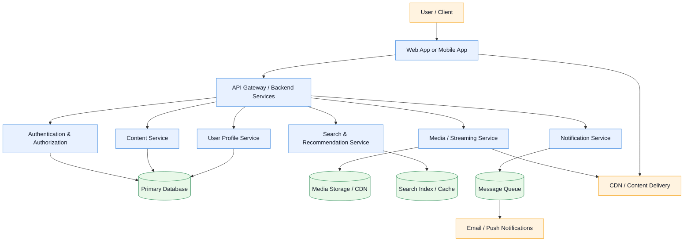

# Architecture Overview

This document presents a high-level architecture for the entertainment application.

## Components

- Client layer: web or mobile front end used by users.
- API gateway: entry point for requests and orchestration.
- Authentication & Authorization: manages user identity, sessions, and permissions.
- Content Service: handles entertainment catalog, categories, and metadata.
- User Profile Service: manages preferences, history, and account data.
- Media / Streaming Service: serves video, audio, and multimedia assets.
- Search & Recommendation Service: indexes content and exposes personalized recommendations.
- Notification Service: triggers email, push, or in-app notifications.
- Data stores: primary database, search index, media storage, and messaging systems.

## Notes

This architecture is intentionally modular so the platform can evolve independently across features, scale horizontally, and integrate new services without impacting the entire application.